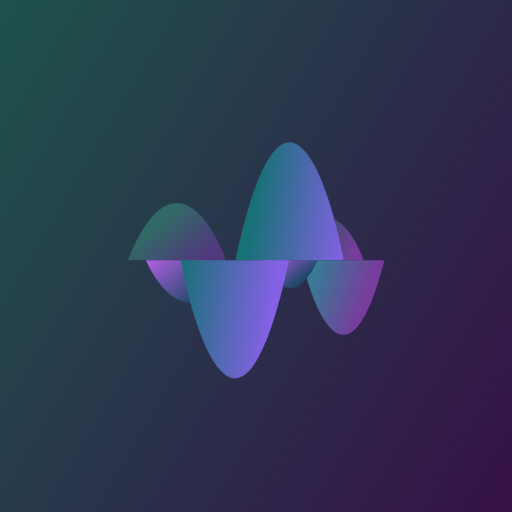
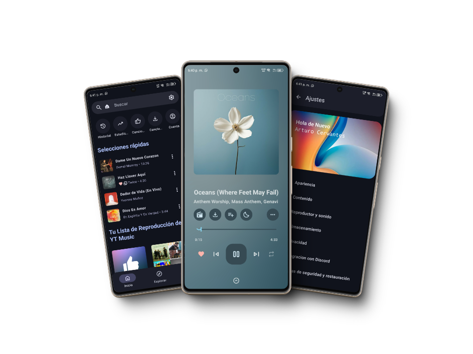

# OpenTune

  
  
  **Un cliente de YouTube Music con Material Design 3, para Android**
  
  
  
  
  
  
  [📱 Descargar APK](https://codeberg.org/Arturo254/OpenTune/releases) • [🌐 Sitio Web](https://opentune.arturodev.com) • [📋 Reportar Bug](https://opentune.arturodev.com/from.html)

## ✨ Características Principales

### 🎨 **Diseño Moderno**
- **Material Design 3**: Interfaz moderna con colores vivos y transiciones suaves
- **Tema adaptable**: Soporte para modo claro y oscuro
- **Interfaz intuitiva**: Navegación simplificada y personalizable

### 🎵 **Funciones Musicales**
- **Reproducción de alta calidad**: Audio optimizado para diferentes dispositivos
- **Búsqueda avanzada**: Explora un amplio catálogo musical
- **Recomendaciones inteligentes**: Basadas en tus preferencias y hábitos
- **Listas de reproducción**: Crea y organiza tu música favorita
- **Descargas offline**: Escucha sin conexión a internet

### 🔧 **Funcionalidades Avanzadas**
- **Control por voz**: Maneja la reproducción con comandos de voz
- **Soporte Chromecast**: Transmite a dispositivos externos
- **Conectividad Bluetooth**: Reproduce en dispositivos inalámbricos
- **Gestión de biblioteca**: Organización avanzada con filtros
- **Sincronización**: Integración completa con tu cuenta de YouTube Music

### 🌍 **Soporte Internacional**
- **Multilingüe**: Español, English, Português
- **Localización cultural**: Traducciones precisas y relevantes
- **Actualizaciones continuas**: Mejoras regulares y nuevas funciones

## 📱 Capturas de Pantalla

  

## 🚀 Instalación

### Android
1. Descarga el APK desde [Releases](https://codeberg.org/Arturo254/OpenTune/releases)
2. Habilita la instalación de aplicaciones de fuentes desconocidas
3. Instala el archivo APK descargado
4. ¡Disfruta de OpenTune!

### Windows
1. Descarga el archivo EXE desde [Releases](https://codeberg.org/Arturo254/OpenTune/releases)
2. Ejecuta el instalador
3. Sigue las instrucciones de instalación

## 🛠️ Tecnologías Utilizadas

- **Android**: Kotlin
- **UI/UX**: Material Design 3
- **Backend**: API de YouTube Music
- **Web**: HTML5, CSS3, JavaScript
- **Frameworks**: BeerCSS, Material Icons

## 📋 Requisitos del Sistema

### Android
- Android 6.0 (API nivel 23) o superior
- 50 MB de espacio libre
- Conexión a internet para streaming

### Windows
- Windows 10 o superior
- 100 MB de espacio libre
- Conexión a internet

## 🤝 Contribuir

¡Las contribuciones son bienvenidas! Si quieres contribuir al proyecto:

1. Haz fork del repositorio
2. Crea una rama para tu feature (`git checkout -b feature/nueva-caracteristica`)
3. Commit tus cambios (`git commit -am 'Añadir nueva característica'`)
4. Push a la rama (`git push origin feature/nueva-caracteristica`)
5. Abre un Pull Request

### 🐛 Reportar Problemas
- [Reportar un bug](https://opentune.netlify.app/from.html)
- [Solicitar una característica](https://opentune.netlify.app/from)

## 📞 Contacto y Soporte

- **Desarrollador**: [Arthur Dev Studio](https://g.dev/Arturo254)
- **WhatsApp**: [+55 76 8479-25](https://wa.me/5576847925)
- **GitHub**: [@Arturo254](https://github.com/Arturo254)
- **Sitio Web**: [opentune.netlify.app](https://opentune.netlfy.app)

## 📄 Licencia

Este proyecto está licenciado bajo la Licencia MIT. Consulta el archivo [LICENSE](./LICENSE) para más detalles.

## 🙏 Agradecimientos

- Gracias a todos los [contribuidores](https://opentune.netlify.app/contribuidores/contribuidores) que han hecho posible este proyecto
- Material Design team por las guías de diseño
- Comunidad de YouTube Music por el feedback

## 📊 Estadísticas del Proyecto

  

---

  
**¿Te gusta OpenTune? ¡Dale una ⭐ al repositorio!**

© 2024 [Arturo.inc™](https://github.com/Arturo254). Todos los derechos reservados.

